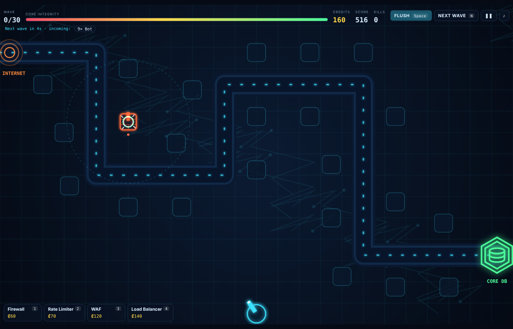
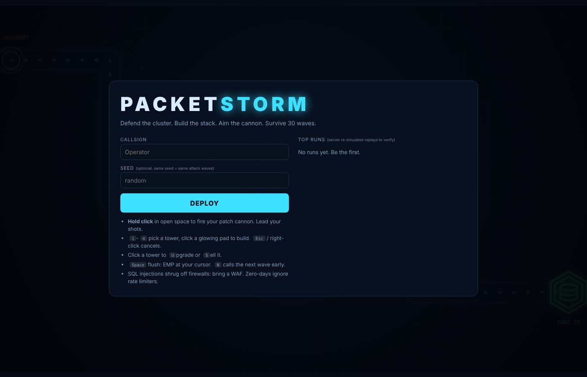
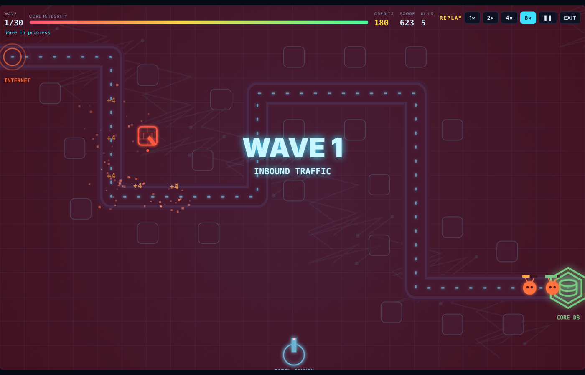
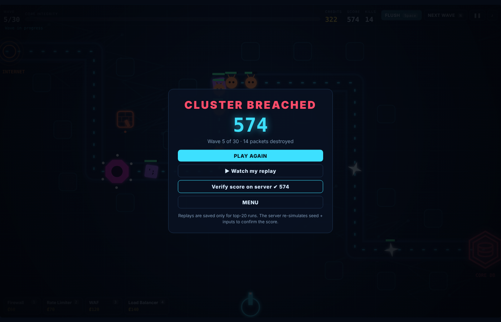
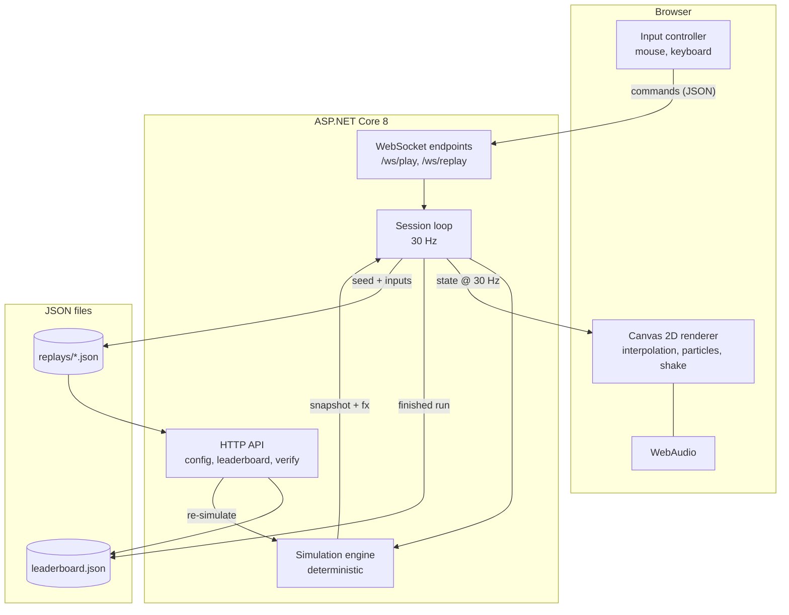
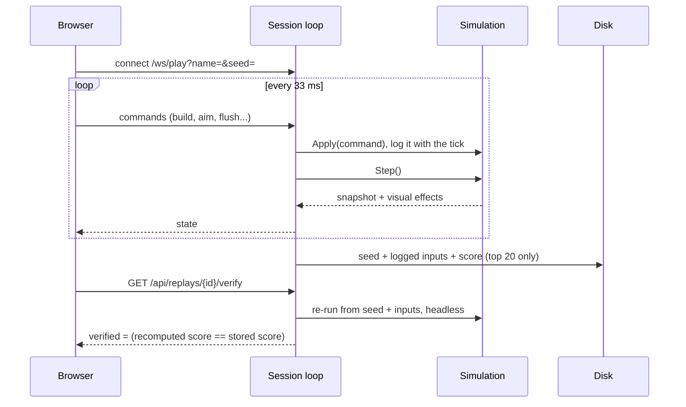

<div align="center">

# ⚡ PACKET STORM

### Defend your Core. Survive the internet.

A real-time cyber-defense tower-defense game with a **server-authoritative, deterministic simulation**, built with **C# and ASP.NET Core 8**.
Build a defensive stack, aim a patch cannon by hand, and survive 30 waves of increasingly nasty attacks.

[](https://github.com/ipranav1508/packet-storm/actions/workflows/ci.yml)


### 🎮 [Play it live](https://YOUR-APP.onrender.com) <!-- replace with your real URL after deploying -->

**No game engine. No external APIs. No third-party NuGet packages.**
Just C#, .NET 8, WebSockets and Canvas 2D.



</div>

<!-- Tip: record a 20-30 s GIF of a wave (build, aim, flush) and drop it in docs/demo.gif, then add:  -->

---

## Table of contents

- [Overview](#-overview)
- [Screenshots](#-screenshots)
- [Features](#-features)
- [How to play](#-how-to-play)
- [Game design reference](#-game-design-reference)
- [Architecture](#-architecture)
- [Engineering deep dive](#-engineering-deep-dive)
- [Testing and determinism](#-testing-and-determinism)
- [Tech stack](#-tech-stack)
- [Getting started](#-getting-started)
- [Deploy it](#-deploy-it)
- [API reference](#-api-reference)
- [Project structure](#-project-structure)
- [Customization](#-customization)
- [Known limitations](#-known-limitations)
- [Roadmap](#-roadmap)
- [License](#-license)

---

## 🎮 Overview

The internet is attacking.

Bots, DDoS swarms, SQL injections, zero-days, ransomware and botnets are marching along the network toward your **Core DB**. You have two ways to stop them, and the game is about using both at once:

1. **Build**: place Firewalls, Rate Limiters, WAFs and Load Balancers on build pads, spend credits wisely, and upgrade what works.
2. **Shoot**: hold the mouse to fire a **patch cannon** yourself. Shots travel through space, so you must lead moving targets. Trigger an **EMP Flush** when a boss or a pile-up gets close.

Survive **30 waves**. Lose when the Core's integrity hits zero.

Every run is recorded as `seed + timestamped inputs`, so the server can **replay it, play it back to you at up to 8×, and re-simulate it headless to verify the score**.

## 📸 Screenshots

| Menu and leaderboard | Replay viewer |
|---|---|
|  |  |

| Game over and server-side score verification |
|---|
|  |

## ✨ Features

| | |
|---|---|
| 🛡️ **Strategic tower defense** | Four defensive structures with different strengths and weaknesses, three upgrade levels each, 23 build pads, and a tight economy. |
| 🎯 **Manual combat** | A patch cannon you aim yourself. Projectiles have travel time, so skill matters. |
| ⚡ **EMP Flush** | An area burst with a 22-second cooldown, aimed at your cursor. |
| 👾 **Six threat types** | Each one counters a different part of your defense, plus a boss every fifth wave. |
| 🧠 **Server-authoritative** | All game logic runs in C# on the server. The browser only sends inputs and draws snapshots. |
| 🔁 **Deterministic replays** | The same seed and inputs always reproduce the same game. |
| 🏆 **Verified leaderboard** | Top runs are stored with their replays. A **Verify** button asks the server to re-simulate the run and confirm the score. |
| 🎬 **Replay viewer** | Watch any stored run back at 1×, 2×, 4× or 8×. |
| 🤖 **Headless test harness** | Bots play full games and the suite checks rules, determinism and balance with no UI and no test framework. |
| 🎨 **Custom renderer** | Glow, particles, screen shake, snapshot interpolation and WebAudio sound, with no libraries. |
| 🔌 **Isolated sessions** | Every WebSocket connection gets its own game state. |

## 🕹️ How to play

### Controls

| Input | Action |
|---|---|
| **Hold left click** in open space | Fire the patch cannon toward your cursor |
| `1` `2` `3` `4` | Select Firewall / Rate Limiter / WAF / Load Balancer |
| **Click a glowing pad** | Build the selected tower (stay in build mode to place more) |
| **Click a tower**, then `U` | Upgrade (up to level 3) |
| **Click a tower**, then `S` | Sell for a 60% refund |
| `Space` | EMP Flush at the cursor |
| `N` | Call the next wave early for bonus credits |
| `P` | Pause / resume |
| `M` | Mute / unmute |
| `Esc` or right-click | Cancel selection |

### Tips

- **Read the wave preview** in the top bar before the wave starts.
- **SQL injections shrug off firewalls** (×0.4 damage). Bring a WAF (×2.0).
- **Zero-days ignore rate limiters.** Kill them with burst damage and your cannon.
- **Ransomware steals 60 credits** if it reaches the core. Do not let it through.
- **Put towers where the path bends.** A pad that covers two path segments does double duty.
- **Spend credits early.** Idle credits do nothing, and early towers pay for themselves.

## 📊 Game design reference

Everything below lives in [`Sim/Defs.cs`](Sim/Defs.cs).

### Defenses

| Tower | Cost | Range | Damage | Fire interval | Notes |
|---|---:|---:|---:|---:|---|
| 🔥 **Firewall** | ₡60 | 125 | 8 | 0.40 s | Cheap and fast. ×0.4 vs SQL injection. |
| ⏱️ **Rate Limiter** | ₡70 | 115 | none | none | Slows enemies in range by 40% / 50% / 60% (levels 1–3). Zero-days are immune. |
| 🎯 **WAF** | ₡120 | 195 | 42 | 1.45 s | Targets the highest-HP enemy. ×2.0 vs SQL injection. |
| 💥 **Load Balancer** | ₡140 | 145 | 26 splash | 1.60 s | Hits everything within 58 px of the target. |

**Upgrades:** each level adds +65% damage and +8% range and cuts the fire interval by 10%. Upgrade cost is `0.75 × base cost × current level`. Selling refunds 60% of everything invested.

### Threats

| Enemy | HP | Speed | Reward | Core damage | Notes |
|---|---:|---:|---:|---:|---|
| 🤖 **Bot** | 32 | 56 | ₡5 | 1 | The baseline attacker |
| 🐝 **Swarm** | 13 | 100 | ₡3 | 1 | Arrives in bursts of up to 6 |
| 💉 **SQL Injection** | 95 | 50 | ₡12 | 2 | Armoured against firewalls |
| ⚡ **Zero-day** | 62 | 125 | ₡16 | 3 | Very fast, cannot be slowed |
| 🔒 **Ransomware** | 340 | 34 | ₡32 | 5 | Steals 60 credits on a leak |
| 👑 **Botnet** (boss) | 1500 | 27 | ₡160 | 20 | Every 5th wave |

Base HP is multiplied by `1 + 0.27·(w−1) + 0.024·(w−1)²` on wave `w`. Kill rewards are paid at 70% of the listed value.

### Waves

Each wave is generated from a **threat budget** (`14 + 13 × wave`). Enemy types unlock progressively:

| Wave | Unlocks |
|---|---|
| 1 | Bots |
| 2 | Swarms |
| 3 | SQL injections |
| 5 | Zero-days |
| 7 | Ransomware |
| every 5th | Botnet boss |

The next wave's exact composition is generated in advance, so the HUD preview is always correct.

### Economy and scoring

- Start with **₡220** and **100** core integrity.
- Clearing a wave pays `20 + 4 × wave` credits. Calling the next wave early pays 2 credits per second skipped.
- **Score** = `wave × 100 + kills × 3 + credits ÷ 10 + core integrity × 5`, plus 1000 for clearing wave 30.

### Your weapons

| | Value |
|---|---|
| 🎯 Patch cannon | 9 damage, about 4.3 shots/s, projectile speed 520 px/s, range 560 px |
| ⚡ EMP Flush | 130 damage to everything within 115 px, 22 s cooldown |

### Balance (from the self-test, 6 seeds)

| Strategy | Waves reached |
|---|---|
| Doing nothing | 4–5 |
| Towers only, naive bot | 10–15 |
| Towers + perfect-aim cannon + flush, naive bot | 19–25 |

Clearing all 30 waves requires smarter tower choices than the test bot makes, plus good manual play.

## 🏗️ Architecture



### Life of a run



## 🔬 Engineering deep dive

### 1. Deterministic fixed-step simulation

The game advances in fixed **30 Hz** steps. `Simulation.Step()` has no wall-clock, no I/O and no hidden state, only the previous state plus the inputs applied before the step. Tick order is fixed:

1. Wave management and spawn queue
2. Rate limiter slows
3. Enemy movement and core leaks
4. Tower firing
5. Operator cannon firing
6. Projectile movement and hits
7. Death resolution and rewards
8. Cooldowns, wave-cleared check, game-over check

### 2. Own RNG

`Sim/Rng.cs` is a small xorshift32 generator. Wave composition and spawn spacing all come from it, so results do not depend on the runtime's `System.Random` implementation.

### 3. Replays are inputs, not video

A run is stored as (illustrative values):

```json
{
  "id": "a1b2c3d4e5f6",
  "name": "Toji",
  "seed": 42,
  "score": 5470,
  "wave": 21,
  "commands": [
    { "tick": 12,  "cmd": { "t": "build", "pad": 4, "kind": 0 } },
    { "tick": 130, "cmd": { "t": "aim", "x": 300, "y": 320, "fire": true } }
  ]
}
```

Only inputs that actually changed the game are logged, and aim updates are only streamed while firing, so replay files stay small.

### 4. Server-side verification

`GET /api/replays/{id}/verify` loads the stored run, re-simulates it headless as fast as the CPU allows, and compares the recomputed score with the stored one. That is the foundation of an anti-cheat story: **scores are earned by the server's simulation, not claimed by a client.**

### 5. Server-authoritative networking

The browser never decides an outcome. It sends small JSON commands and draws what the server reports. Inputs are rate-limited (oversized or flooding frames are dropped), clamped to the playfield, and validated by the simulation itself (cost, occupied pad, cooldowns).

### 6. Client-side interpolation

Snapshots arrive at 30 Hz. The renderer runs at the display's refresh rate and interpolates enemy and projectile positions between the two most recent snapshots, so motion stays smooth on 60/120/144 Hz screens.

### 7. Data-driven balance

Enemy stats, tower stats, map geometry and scaling formulas are all in `Sim/Defs.cs`. The browser fetches what it needs from `/api/config`, so the client never hard-codes balance numbers.

### 8. Isolation by construction

Each WebSocket connection constructs its own `Simulation`. There is no shared mutable game state between players.

## 🧪 Testing and determinism

```bash
dotnet run -- --selftest
```

This runs entirely headless, with no browser and no test framework. It covers:

- **Map validation**: every build pad sits at least 45 px off the enemy path, inside the playfield, and never overlaps another pad.
- **Rule checks**: build cost, one tower per pad, upgrade, sell refund, flush cooldown, tower-versus-enemy matchups, slow immunity.
- **RNG reproducibility.**
- **Balance sweep**: for 6 seeds, an idle run, a towers-only bot, and a towers + cannon + flush bot play complete games.
- **Replay fidelity**: the bot's recorded inputs are replayed through the same code path the server uses, and the result must match the original run exactly (score, wave and kills).
- **Same seed, same inputs, identical result.**

## 🛠️ Tech stack

| Technology | Used for |
|---|---|
| **C# 12 / .NET 8** | Simulation, hosting, tests |
| **ASP.NET Core** | Minimal HTTP API and WebSocket hosting |
| **WebSockets** | Real-time command and snapshot transport |
| **HTML5 Canvas 2D** | Rendering |
| **Vanilla JavaScript** | Input, interpolation, effects |
| **CSS** | HUD and menus |
| **WebAudio API** | Procedural sound effects (no audio files) |
| **JSON files** | Leaderboard and replay storage |

**Dependencies: the .NET 8 SDK only.**

## 🚀 Getting started

### Prerequisites

- [.NET 8 SDK](https://dotnet.microsoft.com/download)
- A modern browser

### Run

```bash
git clone https://github.com/ipranav1508/packet-storm.git
cd packet-storm
dotnet run
```

Open **http://localhost:5090** and press **DEPLOY**.

### Other commands

```bash
dotnet run -- --selftest                          # headless tests and balance sweep
dotnet watch run                                  # hot reload while editing
ASPNETCORE_URLS=http://0.0.0.0:8080 dotnet run    # serve on your network
```

### Same seed, same attack

Enter a number in the **Seed** box to get the same waves every time, which is useful for practising or racing a friend on identical conditions.

## ☁️ Deploy it

The repo includes a `Dockerfile` that honours the `PORT` environment variable, so it runs on any container host.

```bash
docker build -t packet-storm .
docker run -p 8080:8080 packet-storm      # http://localhost:8080
```

**Render (free tier):** New → Web Service → connect this repo → Runtime **Docker** → Instance type **Free** → Create. WebSockets work out of the box, and the game's client switches to `wss://` automatically on HTTPS.

Notes for free hosts: the service sleeps after about 15 minutes with no traffic (the first visit then takes about a minute to wake it), and the filesystem is ephemeral, so the leaderboard and replays reset on every restart or redeploy. For a permanent leaderboard, swap `RunStore` for a database.

## 🔌 API reference

### HTTP

| Method | Endpoint | Description |
|---|---|---|
| `GET` | `/api/config` | Map, pads, tower and enemy data for the client |
| `GET` | `/api/leaderboard` | Top 10 runs |
| `GET` | `/api/replays/{id}/verify` | Re-simulate a stored run and compare scores |

Example verify response (illustrative values):

```json
{ "ok": true, "verified": true, "claimed": 5470, "recomputed": 5470, "commands": 412 }
```

### WebSocket

| Endpoint | Purpose |
|---|---|
| `/ws/play?name=&seed=` | Live game: JSON commands in, JSON snapshots out at 30 Hz |
| `/ws/replay?id=` | Stream a stored replay. Send `{"t":"speed","id":1\|2\|4\|8}` or `{"t":"pause"}`. |

### Commands

| Command | Parameters | Effect |
|---|---|---|
| `build` | `pad`, `kind` (0–3) | Build a tower |
| `upgrade` | `id` | Upgrade a tower |
| `sell` | `id` | Sell a tower |
| `aim` | `x`, `y`, `fire` | Aim and start/stop the cannon |
| `flush` | `x`, `y` | EMP burst |
| `nextwave` | none | Call the next wave early |
| `pause` | none | Toggle pause |

### Snapshot (server → browser, abbreviated)

```json
{
  "type": "state", "tick": 1840, "wave": 6, "maxWave": 30, "waveActive": true,
  "core": 87, "credits": 143, "score": 1265, "kills": 71, "flush": 0.62,
  "next": { "Bot": 9, "Swarm": 6 },
  "enemies": [[id, kind, x, y, hpFraction, slowed]],
  "towers":  [[id, kind, pad, level, angle, cooldown]],
  "shots":   [[id, x, y]],
  "fx":      [["beam", x1, y1, x2, y2, kind], ["kill", x, y, kind, reward]]
}
```

## 📁 Project structure

```
PacketStorm/
├── Program.cs               Minimal API, WebSocket endpoints, startup, --selftest switch
├── PacketStorm.csproj
├── SelfTest.cs              Headless bots, rule checks, determinism and replay checks
├── Sim/
│   ├── Defs.cs              All balance data: map, pads, towers, enemies, scaling
│   ├── Sim.cs               The deterministic simulation engine
│   └── Rng.cs               xorshift RNG and geometry helper
├── Services/
│   ├── Sessions.cs          Live-play and replay WebSocket loops (30 Hz)
│   └── Stores.cs            Leaderboard, replay files, headless Replayer
├── wwwroot/
│   ├── index.html
│   ├── style.css
│   └── game.js              Canvas renderer, input, interpolation, audio
├── data/                    leaderboard.json and replays/ (created on first finished run)
└── docs/screenshots/
```

## ⚙️ Customization

| Want to... | Change |
|---|---|
| Make it easier or harder | `HpScale` in `Defs.cs`; the `budget` formula in `Sim.BuildWave`; the 0.7 reward factor in `Sim.ReapDead` |
| Change the map | `Path` and `Pads` in `Defs.cs` (the self-test verifies pad placement) |
| Add a tower | Add a row to `Defs.Towers`, handle it in `Sim.FireTowers`, add a case to `drawTower` in `game.js` |
| Add an enemy | Add a row to `Defs.Enemies`, give it a case in `BuildWave`, add a case to `drawEnemy` in `game.js` |
| Tune the cannon | `OperatorDamage`, `OperatorCooldownTicks`, `OperatorSpeed`, `OperatorRange` |
| Tune the flush | `FlushRadius`, `FlushDamage`, `FlushCooldownTicks` |
| Change game length | `MaxWave` |

After any balance change, run `dotnet run -- --selftest` to re-check the difficulty curve.

## ⚠️ Known limitations

- **Determinism scope:** replays are guaranteed to reproduce on the same runtime and CPU architecture. The simulation uses double-precision floating point, which could in principle differ across architectures.
- **Single process:** live sessions are held in memory in one server process, with no clustering or reconnect-to-session support. Closing the tab ends the run.
- **File storage:** the leaderboard and replays are plain JSON files, which is fine for a demo but not for heavy concurrent use. `RunStore` is the single class to swap for a database.
- **No authentication:** callsigns are free text.
- **Replays are only kept for the top 20 runs.**

## 🗺️ Roadmap

- [ ] Database-backed `RunStore` (SQL Server or MongoDB)
- [ ] Daily seeded challenge with its own leaderboard
- [ ] More towers and enemy modifiers (shielded, regenerating, flying)
- [ ] Second map and map selection
- [ ] Touch-friendly controls
- [ ] Docker image and one-click deploy
- [ ] Spectate a live run over WebSockets

## 📜 License

Released under the [MIT License](LICENSE).

---

<p align="center">
<b>⚡ DEFEND YOUR CORE. STOP THE STORM. ⚡</b><br/>
Built with C# and a little bit of chaos.
</p>
